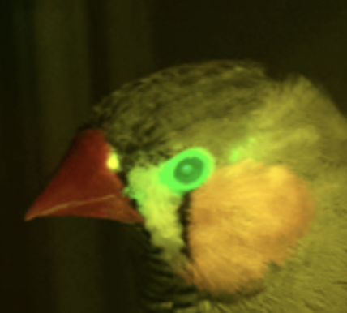
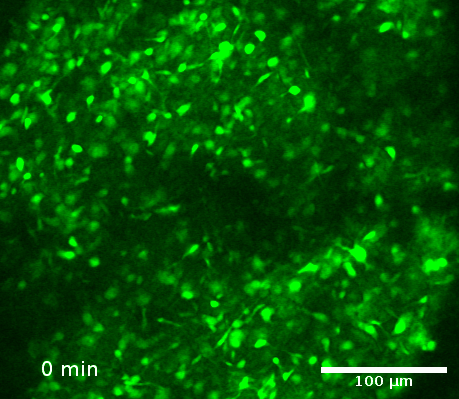
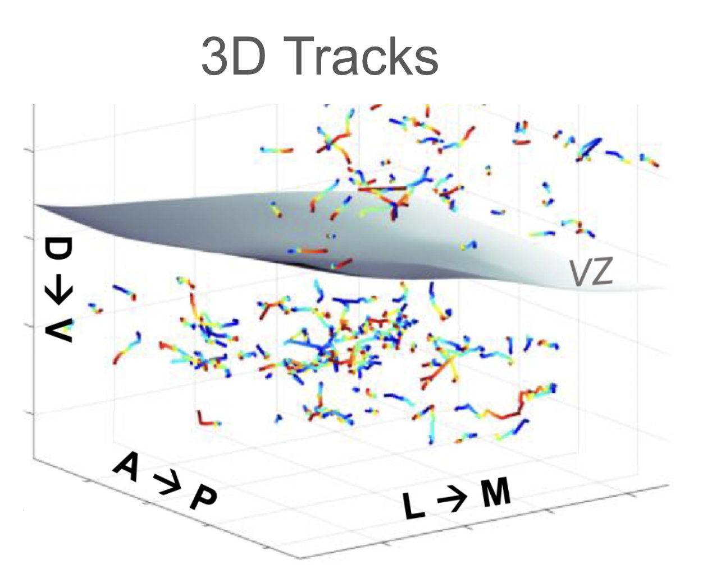
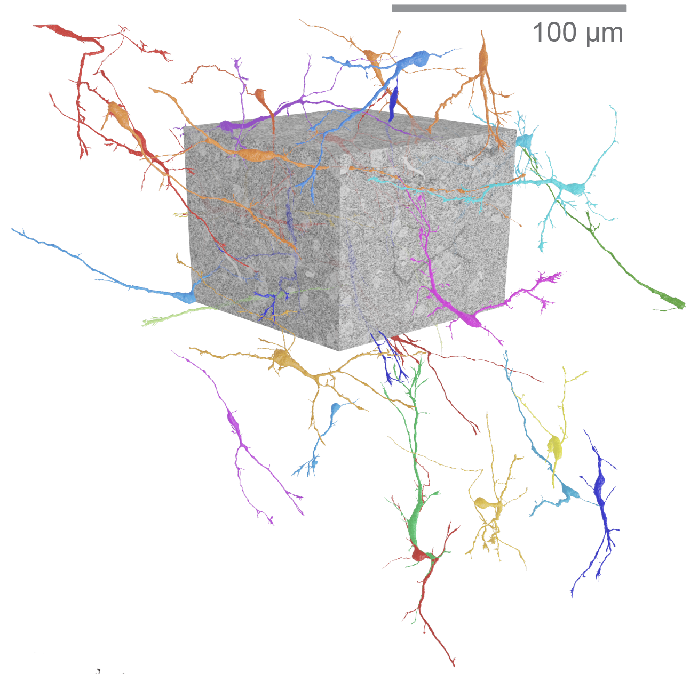
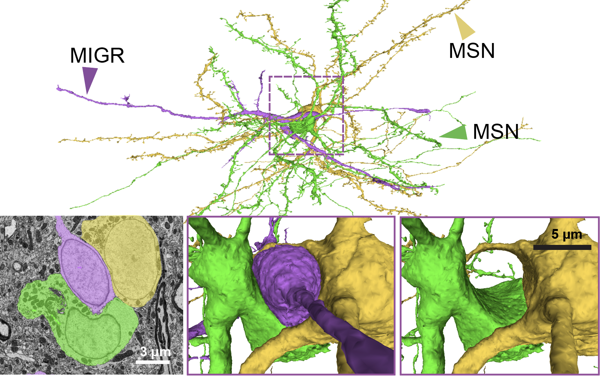

I am a neuroscientist and postdoctoral associate in Dr. Shawn Sorrells’ lab at the University of Pittsburgh. I study plasticity in circuits after birth: how immature neurons travel, mature, and join circuits that are already working.

One question runs through my work: **how can circuits that undergo massive structural change, such as taking in new neurons, reorganize to coordinate complex natural behaviors?**

During my PhD with Dr. Ben Scott at Boston University, I approached it in adult songbirds, which add new neurons to their brains throughout life. Currently, I study the paralaminar nucleus of the amygdala, a region that holds a reserve of immature neurons that mature across adolescence in mammals, including humans.

My work combines in vivo and in vitro imaging, quantitative anatomy, connectomics, and modeling, as well as the development of custom experimental tools and analyses.

Approaches
======

* **In vivo deep-brain and chronic imaging.** Two- and three-photon microscopy in living animals, through cranial windows, GRIN lenses, and microprisms, in both songbirds and mice. I brought in vivo imaging to transgenic songbirds and helped establish three-photon imaging in songbirds.
* **In vitro imaging.** Ongoing development of platforms for calcium imaging in organotypic slice cultures from both mice and human neurosurgical resections, to study developmental network dynamics.
* **Software tools.** AI-assisted development of highly individualized software tools, ranging from data analysis pipelines to anatomical reconstruction from histology to personal management platforms. See [Tools](/tools/).
* **From cells to circuits.** Tracking hundreds of migrating neurons over hours, modeling their population dynamics, and finding them in a full EM connectome to see how they physically interact with the circuit around them. In slice cultures from mice and humans, I am extending this to how maturing neurons take part in developing network activity.

PhD work: how new neurons move through an adult brain
======

My PhD research in the Scott Lab focused on neuron migration in adult zebra finches. Songbirds generate new neurons throughout their lives. These new neurons migrate widely through the brain before integrating into song-relevant circuitry. How they could disperse through the intact adult brain, with its high density of other cells and synapses, was not clear.

I recorded migrating neurons with two-photon timelapse imaging in living transgenic zebra finches. They behaved in a disordered way: they dispersed in every direction and turned frequently. I described and modeled their population dynamics as a diffusion-like process. They behaved more like wandering foragers than directed projectiles. Here's that paper: [Shvedov et al. 2024, *Cell Reports*](https://doi.org/10.1016/j.celrep.2024.113759).

   
  <em style="font-size:0.9em;">Transgenic UBC-GFP zebra finch.</em>

   
  <em style="font-size:0.9em;">Adult-born neuron in zebra finch brain.</em>

  
     
    <em style="font-size:0.9em;">3-hr timelapse; migrating neurons</em>
  
  
     
    <em style="font-size:0.9em;">Tracked migratory neuron routes</em>
  

Next, I wanted to know what mechanisms underlie this migration. Could cells be using a winding scaffold, such as blood vessels, to move through the brain this way? Do migrating neurons avoid other neurons and synapses? If not, do they disrupt the working circuitry of the adult brain?

  
   <em>Migratory neurons found in the songbird EM connectome (Kornfeld et&nbsp;al.)</em>

To answer these questions, we teamed up with the Kornfeld Lab, who built the first fully reconstructed vertebrate basal ganglia EM connectome. It is [available online](https://syconn.esc.mpcdf.mpg.de/) and described in their [preprint](https://www.biorxiv.org/content/10.1101/2025.10.25.684569v1) and on this [website](http://www.songbird-connectomics.org/). The volume comes from a zebra finch basal ganglia, which receives new neurons throughout life. Within it, we identified 35 migratory neurons from their shape and ultrastructure. They did not rely on any particular scaffold. Instead, they contacted many different structures and sat embedded in the synapse-dense neuropil, sometimes deforming the dendritic spines around their elongated cell bodies. Strikingly, they also deformed nearby mature neurons. Sometimes this involved several mature cell bodies and was so severe that the migratory neuron appeared to be "tunneling" through the cluster. These findings reveal a surprising structural flexibility of adult brain circuitry toward migrating neurons. Here's that paper, [Shvedov et al. 2026, *Current Biology*](https://doi.org/10.1016/j.cub.2026.03.057), and a short [video abstract](https://www.youtube.com/watch?v=pVGGSqPoz4I).

  
   <em>A migratory neuron tunneling through a cluster of medium spiny neurons (MSNs)</em>

  

    <iframe src="https://www.youtube-nocookie.com/embed/pVGGSqPoz4I" title="How songbirds fill their brains with new neurons (Current Biology video abstract)" style="position:absolute; top:0; left:0; width:100%; height:100%; border:0;" allow="accelerometer; clipboard-write; encrypted-media; gyroscope; picture-in-picture; web-share" referrerpolicy="strict-origin-when-cross-origin" allowfullscreen loading="lazy"></iframe>
  

  
<em style="font-size:0.9em;">Video abstract for Shvedov et al. 2026, <i>Current Biology</i></em>

See [publications](/publications/) or [CV](/cv/).
