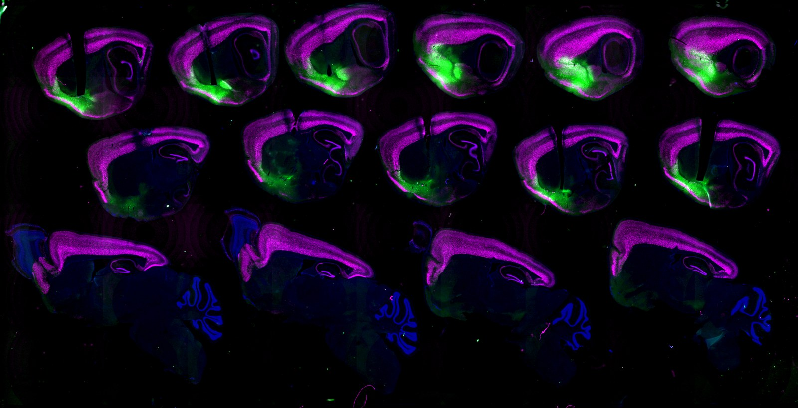
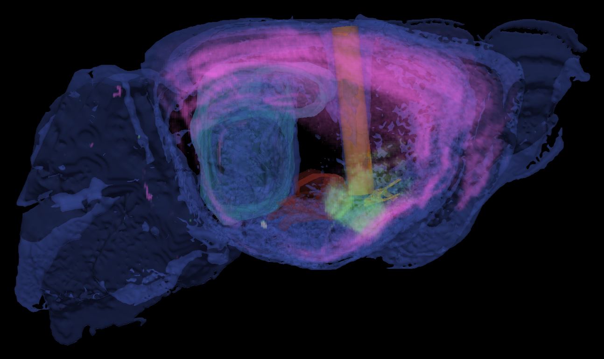
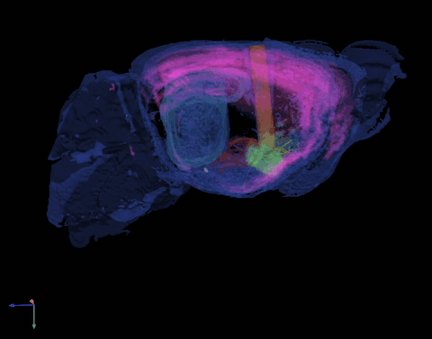
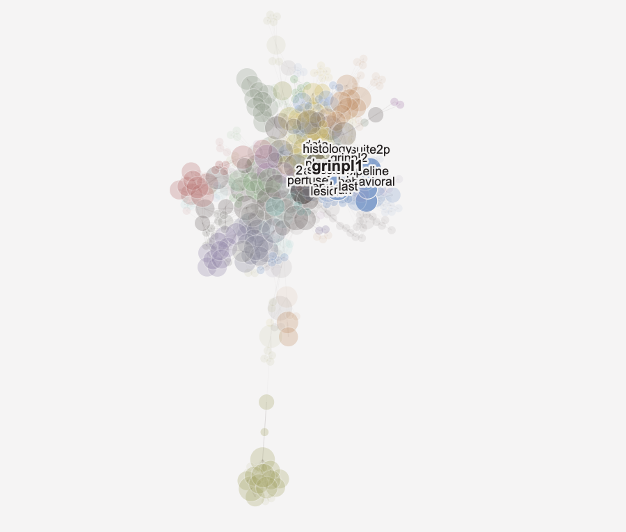
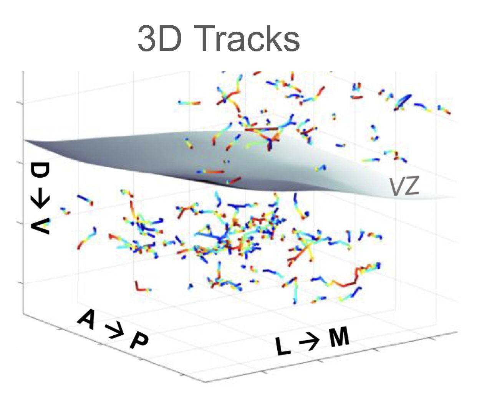

TopoSlice
======

**3D reconstruction from low resolution, serial histological sections**

Take your fluorescence slide scanner images of slide-mounted tissue sections (uniform sectioning not required) and reconstruct them into volumes for visualization and analysis. Reconstruct and calculate the path, implant angle, and imaging field of view of surgically implanted microendoscopes (optional).

  <figure style="flex:1 1 240px; max-width:340px; margin:0; text-align:center; display:flex; flex-direction:column; align-items:center; gap:6px;">
    
    <figcaption style="font-size:0.9em; font-family:inherit; text-align:center; width:100%;"><em>Before: the slide scan</em></figcaption>
  </figure>
  <figure style="flex:1 1 240px; max-width:340px; margin:0; text-align:center; display:flex; flex-direction:column; align-items:center; gap:6px;">
    
    <figcaption style="font-size:0.9em; font-family:inherit; text-align:center; width:100%;"><em>After: the reconstructed volume</em></figcaption>
  </figure>
  <figure style="flex:1 1 240px; max-width:340px; margin:0; text-align:center; display:flex; flex-direction:column; align-items:center; gap:6px;">
    
    <figcaption style="font-size:0.9em; font-family:inherit; text-align:center; width:100%;"><em>The volume, rotating</em></figcaption>
  </figure>

**Status:** work in progress.
<!-- Re-enable when the repo is public: [GitHub repository](https://github.com/naomishved/TopoSlice) -->

ChairPile
======

Turn stream-of-consciousness written or spoken notes into chunkable project tasks. Organize complex multi-project to-do lists, plan out your day every morning, and visualize your niche "language" that expands the more you use ChairPile.

  
   <em style="font-size:0.9em;">The language map: your own words and projects, clustered by how you use them.</em>

<!-- Add when the repo is public: [GitHub repository](https://github.com/naomishved/ChairPile) -->

Songbird neuron migration analysis
======

**[Transgenic-songbird-neuron-migration](https://github.com/naomishved/Transgenic-songbird-neuron-migration)** (MATLAB)

The code behind [Shvedov et al. 2024, *Cell Reports*](https://doi.org/10.1016/j.celrep.2024.113759): visualizing tracked migratory neurons, measuring collective migration, characterizing superdiffusive movement, and simulating migration on biological timescales.

  

